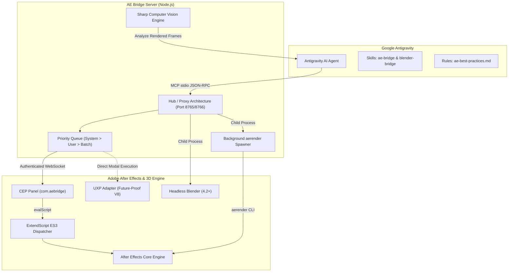

# Antigravity Guide for AE Bridge

AE Bridge integrates seamlessly into Google Antigravity, equipping AI agents with direct, real-time command of Adobe After Effects and Blender.

---

## 1. Quick-Start Configuration

To connect Antigravity to AE Bridge, add the following entry to your Antigravity MCP configuration (`~/.gemini/antigravity/mcp_config.json` or your workspace settings):

### Standard Stdio Mode
```json
{
  "mcpServers": {
    "ae-bridge": {
      "command": "node",
      "args": ["/path/to/ae-bridge/server/dist/index.js"],
      "env": {
        "AE_BRIDGE_PROFILE": "standard"
      }
    }
  }
}
```

### Multi-Client Hub & Proxy Mode
In multi-agent environments, multiple Antigravity agents share a single connection to After Effects via the AE Bridge Hub:
```json
{
  "mcpServers": {
    "ae-bridge": {
      "command": "node",
      "args": ["/path/to/ae-bridge/server/dist/index.js", "proxy"],
      "env": {
        "AE_BRIDGE_PORT": "8765"
      }
    }
  }
}
```

---

## 2. Tool Profiles (`AE_BRIDGE_PROFILE`)

Configure the tool surface to optimize agent context window usage:

| Profile | Tool Count | Intended Use Case |
| :--- | :--- | :--- |
| `minimal` | ~24 | Quick comps, text editing, basic transforms, and render |
| `standard` | ~85 | Full motion graphics, styling, curves, audio, and finish passes (default) |
| `blender` | ~38 | 3D scene authoring, Blender rendering, and AE camera sync |
| `full` | 185 | All features: computer vision metrics, scene graph, MOGRT data, captions |

---

## 3. Workflow Architecture

The diagram below illustrates how Antigravity communicates through AE Bridge with Adobe After Effects and Blender:



---

## 4. Recommended Slash Commands

When working with AE Bridge inside Antigravity, leverage these slash commands:
- `/plan`: Essential before creating multi-layered title sequences or complex VFX shots to agree on composition dimensions, color palette, and timing.
- `/boost`: Deep multi-perspective reasoning for complex 3D scene specifications and optical compositing.
- `/teamwork`: Deploy multiple specialized subagents (e.g., an Art Director agent scoring aesthetic passes, a 3D Blender agent generating assets, and a Compositor agent assembling in AE).
- `/goal`: Launch overnight, long-running batch render jobs and comprehensive video exports.

---

## 5. Sample Agent Prompts

Try these prompts directly in Antigravity:

- **Kinetic Typography:**
  > "Connect to After Effects, create a 1920x1080 30fps comp named 'LaunchPromo', add a rich dark solid, generate kinetic bouncing title text saying 'THE FUTURE OF MOTION', apply the 'bold-hyper' style pack and rich finish pass, run vision QA, and render as an MP4."

- **3D Product Showcase with Blender:**
  > "Validate a 3D turntable scene spec in Blender for a metallic product cube, render 150 frames with Cycles and depth pass enabled, import the render into After Effects, sync the 3D camera, and add a background glow."

- **Automated QA & Scene Graph Export:**
  > "Inspect the active After Effects project, export the 'MainComp' to a JSON scene graph, run ae_measure_comp to evaluate contrast and blur metrics, and report recommendations."
