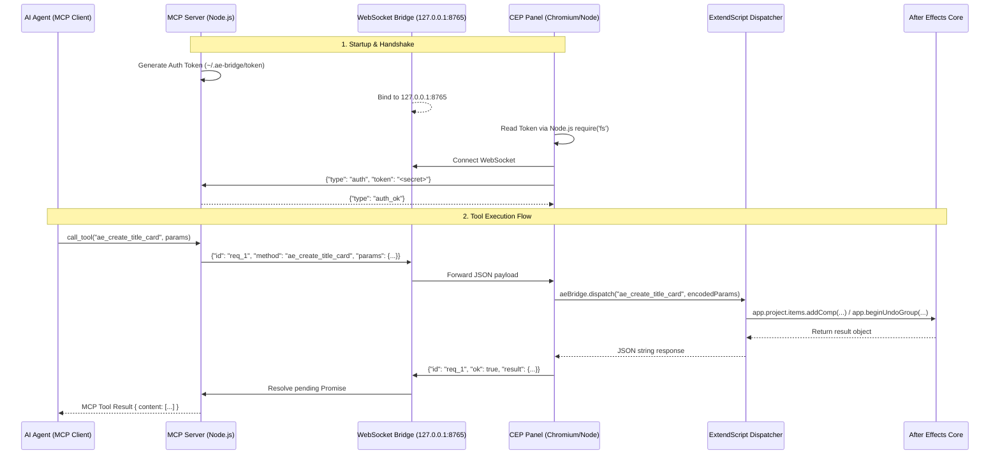

# System Architecture

AE Bridge uses a hybrid decoupled architecture that bridges modern asynchronous TypeScript/Node.js environments with Adobe's synchronous ExtendScript engine.

---

## Component Overview

---

## Communication Protocols

### 1. Model Context Protocol (MCP) over Stdio
The AI client spawns `node server/dist/cli.js` as a subprocess. Standard input and output carry JSON-RPC messages conforming to the open Model Context Protocol specification. All 139 tools, resources, and director prompts are served across this channel.

### 2. Authenticated Local WebSocket (`127.0.0.1:8765`)
Communication between the Node.js MCP server and the After Effects CEP extension is conducted exclusively over a local loopback WebSocket server:
- **Port:** Defaults to `8765` (customizable via `AE_BRIDGE_PORT`).
- **Interface:** Bound strictly to `127.0.0.1` (no remote external listening).
- **Authentication Handshake:** Upon connection, the client must present `{ type: "auth", token: "<token>" }` matching the token stored in `~/.ae-bridge/token` within 3.0 seconds. Unauthenticated connections are terminated immediately.

### 3. ExtendScript Dispatcher (`cep-panel/jsx/dispatcher.jsx`)
The CEP browser runtime evaluates ExtendScript code through Adobe's `csInterface.evalScript` API. To prevent string escaping bugs, all tool invocations are serialized into URL-encoded JSON parameters and routed through `aeBridge.dispatch(method, encodedParams)`.

---

## Memory & Vision Pipeline

For visual self-review, After Effects renders frames directly to a sandboxed temporary directory (`<tmp>/ae-bridge-previews/`). The Node.js server observes file generation, verifies file write completion via byte stability polling, loads the binary image buffer, performs optional compositing and labeling with `sharp`, and encodes the result as standard base64 MCP visual content.
