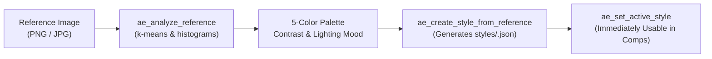

# Design Engine & Visual Styles Guide

The **High-End Design Engine** (introduced in AE Bridge v1.1.0) ensures that all motion graphics, titles, and video deliverables adhere to disciplined, broadcast-quality art direction. Rather than using arbitrary colors or generic linear keyframes, AE Bridge binds compositions to curated visual styles, named cubic motion curves, and multi-layer finishing stacks.

---

## The 12 Production Style Packs

Each style pack defines a complete design system: a 7-color semantic palette, primary and fallback typography, signature easing curves, layer stagger timings, lighting setups, and finishing stacks.

| Style Name | One-Line Description | Signature Curve | Primary Mood |
| :--- | :--- | :--- | :--- |
| **`minimalPremium`** | Architectural clarity, generous negative space, subtle slate gradients, pristine typography, and smooth mathematical eases. | `smooth` | Clean, tech-forward, refined |
| **`neonCyber`** | High-octane cyberpunk aesthetic with electric cyan, searing magenta laser glows, obsidian voids, and instant snap velocity. | `snap` | High-energy, futuristic, synthwave |
| **`techHUD`** | Tactical telemetry interface, deep navy slate backdrops, laser cyan data lines, amber status warnings, and monospace typography. | `snap` | Aerospace, telemetry, cybernetic |
| **`luxuryGold`** | Opulent champagne and burnished gold leaf textures, obsidian marble surfaces, regal serif typography, and majestic slow-motion pacing. | `smooth` | Premium, aspirational, haute couture |
| **`cinematicNoir`** | Deep atmospheric shadows, silvery tungsten key highlights, subtle anamorphic streak flares, and deliberate weighted pacing. | `heavy` | Dramatic intrigue, thriller, prestige cinema |
| **`brutalistBold`** | Raw industrial concrete geometry, high-visibility hazard orange accents, massive condensed type blocks, and uncompromising mechanical punch. | `heavy` | Underground, streetwear, rebellious |
| **`editorialSwiss`** | Bold asymmetric typography, disciplined modular grid structure, stark crimson red focus against monochrome slate, and razor-sharp cuts. | `expoOut` | Modernist, publishing, high design |
| **`epicTrailer`** | Monumental dark obsidian titanium, molten amber forge glows, volcanic ember particles, slow thunderous pushes, and blockbuster impact. | `heavy` | Hollywood blockbuster, cinematic games |
| **`kineticPop`** | High-saturation cobalt blue, vibrant marigold yellow, snappy elastic bouncing text, playful overshoot geometry, and dynamic pop motion. | `backOut` | Commercials, youth culture, entertainment |
| **`organicSoft`** | Earthy sage, warm sun-baked terracotta, tactile clay tones, gentle botanical diffusion, and smooth flowing fluid deceleration. | `smooth` | Sustainable, wellness, artisanal |
| **`dreamyPastel`** | Ethereal lavender sky, soft blush rose, diffuse powder blue bokeh, dreamy floating deceleration, and luminous angelic glow. | `quintOut` | Ambient, lifestyle, fantasy |
| **`y2kChrome`** | Liquid mercury chrome textures, iridescent lilac and sky blue refractions, bubble geometry, chromatic dispersion, and playful bounce. | `elasticOut` | Retro-futurism, digital nostalgia, fashion |

---

## Activating and Inspecting Styles

### List All Available Styles
Call `ae_list_styles`:
```json
{}
```
Returns all bundled and user-created style definitions stored in `styles/*.json`, including the currently active style.

### Set the Active Global Style
Call `ae_set_active_style`:
```json
{
  "style": "darkLuxury"
}
```
All subsequent builders (kinetic titles, lower thirds, storyboards, 3D scenes, and finishing passes) will automatically reference the active style's palette, fonts, and motion language.

---

## Creating a Style From a Reference Image

AE Bridge can ingest any moodboard frame, concept art piece, or brand screenshot and distill it into a custom, production-ready style pack.

### Workflow: 3 Simple Steps



#### Step 1: Analyze the Image
Call `ae_analyze_reference` to extract color and luminance metrics:
```json
{
  "imagePath": "C:/path/to/moodboard_hero.png",
  "numColors": 6
}
```
**Output:**
- Dominant hex palette (`bg`, `surface`, `primary`, `secondary`, `accent`, `text`)
- Dynamic range and luminance contrast ratio
- Lighting mood classification (`highKey`, `lowKey`, `dramaticContrast`, `diffuseSoft`)

#### Step 2: Generate the Style Profile
Call `ae_create_style_from_reference` to synthesize the visual system:
```json
{
  "name": "cyberSunset",
  "imagePath": "C:/path/to/moodboard_hero.png",
  "title": "Cyber Sunset Horizon",
  "description": "Dusk violet gradients with searing orange neon highlights extracted from concept art.",
  "headingFont": "Montserrat",
  "bodyFont": "Inter"
}
```
This generates `styles/cyberSunset.json`, automatically matching:
- Motion curve (e.g. `snap` for high-contrast neon, `heavy` for dramatic dark looks)
- Stagger delays and particle presets
- Lighting rig and finishing look stack

#### Step 3: Compare & Benchmark
Call `ae_compare_to_reference` to verify visual fidelity between your rendered comp and the original moodboard:
```json
{
  "compRef": { "compName": "Product Showcase" },
  "referenceImagePath": "C:/path/to/moodboard_hero.png"
}
```
Returns a similarity score (0–100%) and delta metrics across hue, saturation, and contrast.

---

## Broadcast Finishing Pass (`ae_finish_pass`)

Every high-end composition can be finished with a single call to `ae_finish_pass`:
```json
{
  "compRef": { "compName": "Master Comp" },
  "level": "rich",
  "style": "cinematicNoir"
}
```

This constructs a non-destructive, top-level adjustment group with 10 stacked layers:
1. **`FINISH — Controller`**: Global master intensity slider.
2. **`FINISH — Color Grade`**: Palette tinting and shadow/highlight split grading.
3. **`FINISH — Film Grain`**: Procedural grain texture matched to comp resolution.
4. **`FINISH — Chromatic Aberration`**: Subtle optical lens dispersion at frame edges.
5. **`FINISH — Halation`**: Warm red/amber diffusion around intense highlights.
6. **`FINISH — Bloom & Glow`**: Soft thresholded luminance bleed.
7. **`FINISH — Light Wrap`**: Natural foreground-to-background edge bleed.
8. **`FINISH — Depth Haze`**: Distance-based contrast reduction.
9. **`FINISH — Foreground Atmosphere Dust`**: Subtle floating motes.
10. **`FINISH — Background Atmosphere Texture`**: Procedural organic haze.
